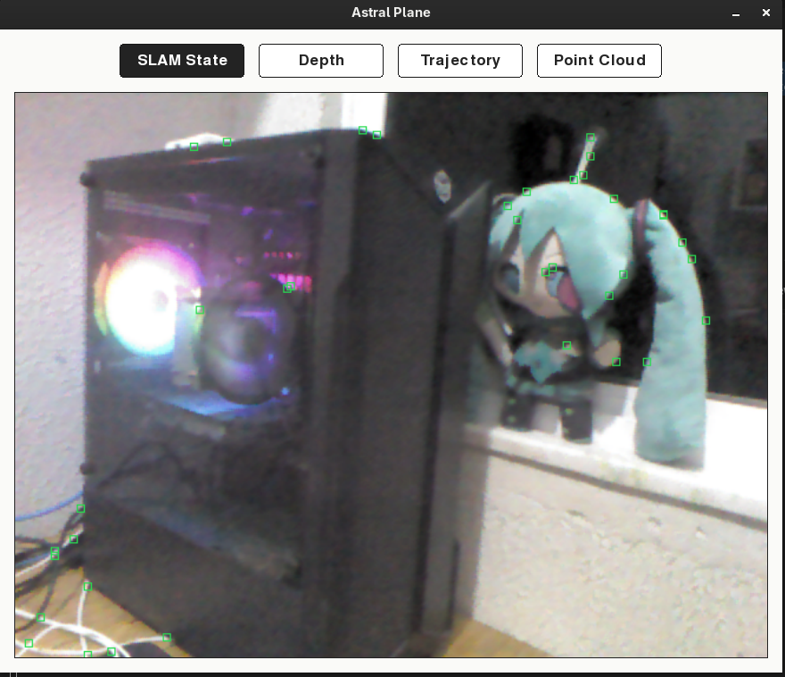
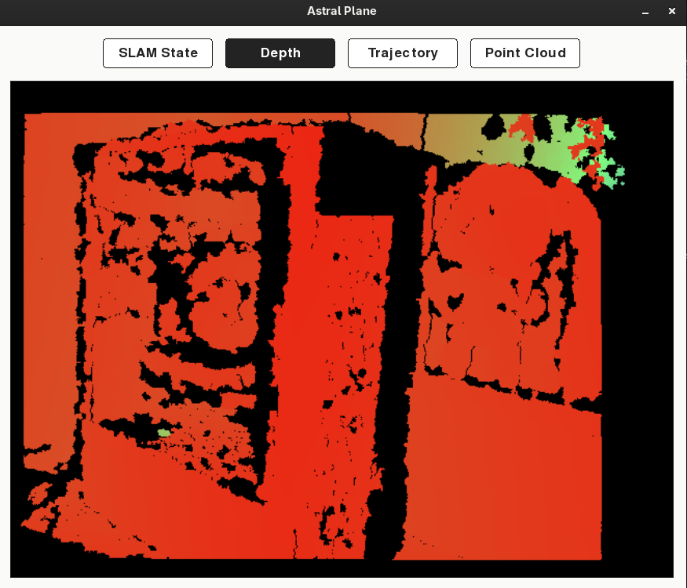
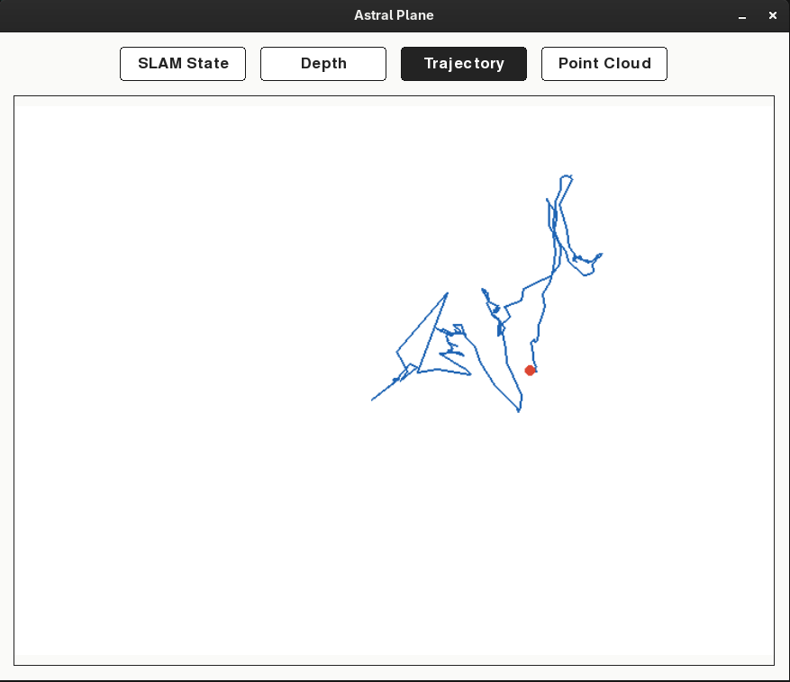
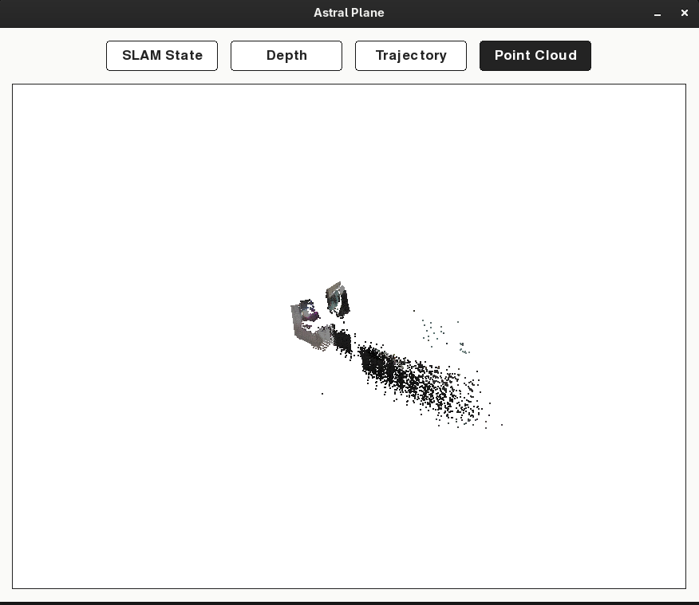

# Astral Plane

Astral Plane is a real-time RGB-D visual SLAM application for the first-generation Microsoft Kinect. It captures color and registered depth frames with libfreenect, tracks the camera pose with ORB-SLAM3, and visualizes the results in a desktop interface.

| SLAM State | Depth |
| --- | --- |
|  |  |

| Trajectory | Point Cloud |
| --- | --- |
|  |  |

## Views

Switch views with the on-screen buttons or keys `1`–`4`:

1. **SLAM State** — the live color image with detected visual features highlighted.
2. **Depth** — a colorized view of the Kinect depth image.
3. **Trajectory** — the camera path estimated from tracked frames.
4. **Point Cloud** — a colored 3D map accumulated from depth frames. Drag to orbit and scroll to zoom.

The trajectory and point cloud depend on successful SLAM tracking. If tracking is lost, those views may pause or contain gaps.

## Requirements

- A connected and powered Kinect v1.
- A compatible Python version and [`uv`](https://docs.astral.sh/uv/).
- The native `libfreenect`, `libusb`, and SDL libraries required by Pygame, with USB access to the Kinect.

## Run

```sh
uv sync
uv run python -m astral_plane
```

The Kinect calibration and ORB-SLAM3 settings are in `assets/KinectV1.yaml`. The ORB-SLAM3 vocabulary archive is in `assets/ORBvoc.txt.tar.gz` and is extracted to the user cache on first run.

Press `Esc` or close the window to exit.
